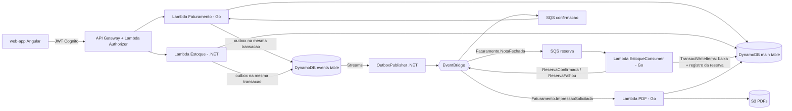

# Emissao NFe

Projeto de portfolio com arquitetura serverless na AWS para cadastro de produtos, controle de estoque, fechamento de notas e geracao assincrona de PDF, com saga coreografada por eventos.

> **Nao e um emissor fiscal oficial.** O codigo nao integra com a SEFAZ, nao gera nem assina XML de NF-e, nao usa certificado A1/A3 e nao calcula tributos. O "ambiente fiscal" existe apenas como configuracao segura por padrao (homologacao, `tpAmb=2`) e como aviso impresso no PDF.

## Componentes

| Diretorio | Linguagem | O que faz |
|---|---|---|
| `servico-faturamento/` | Go 1.25 | 4 Lambdas: API de notas (`cmd/lambda`), consumer de reserva de estoque (`cmd/lambda-estoque-consumer`), gerador de PDF (`cmd/lambda-pdf`) e publicador de outbox por varredura (`cmd/lambda-outbox`, nao provisionado pelo CDK serverless atual) |
| `servico-estoque/` | .NET 8 (testes em net9.0) | API de produtos e reservas (ASP.NET Core minimal API hospedada em Lambda) e `OutboxPublisher` (Lambda acionada por DynamoDB Streams) |
| `web-app/` | Angular 19 | Frontend com login Cognito (Amplify) |
| `infra/cdk/` | TypeScript | Stacks AWS CDK. Entrada ativa: `bin/nfe-infra-serverless.ts` |

## Arquitetura



### Fluxo de fechamento de nota (saga)

1. `PUT /api/v1/notas/{id}/fechar` muda a nota para `FECHADA` e grava `Faturamento.NotaFechada` no outbox na mesma transacao.
2. O `OutboxPublisher` le o stream da tabela de eventos e publica no EventBridge (entrega *at-least-once*).
3. O `EstoqueConsumer` debita o estoque de todos os itens numa unica `TransactWriteItems`, condicionada a `saldo >= quantidade` (nunca negativo) e a nao existir registro de reserva para a nota (idempotente). Publica `ReservaConfirmada` ou `ReservaFalhou`.
4. A Lambda de faturamento move a nota de `FECHADA` para `RESERVADA` ou `CANCELADA` com escrita condicional; eventos reentregues viram no-op. Falhas voltam para a fila (`BatchItemFailures`) e, esgotadas as tentativas, para a DLQ.

### Impressao

`POST /api/v1/notas/{id}/imprimir` responde 202 com uma `SolicitacaoImpressao` `PENDENTE`; a Lambda de PDF gera o arquivo, envia para o S3 e marca `CONCLUIDA`. Fora de producao o PDF traz "AMBIENTE DE HOMOLOGACAO - SEM VALOR FISCAL".

### Rotas

| Servico | Metodo e rota |
|---|---|
| Faturamento | `GET /health`, `GET/POST /api/v1/notas`, `GET /api/v1/notas/{id}`, `POST /api/v1/notas/{id}/itens`, `PUT /api/v1/notas/{id}/fechar`, `POST /api/v1/notas/{id}/imprimir`, `GET /api/v1/solicitacoes-impressao/{id}` |
| Estoque | `GET /health`, `GET/POST /api/v1/produtos`, `GET /api/v1/produtos/{id}`, `POST /api/v1/reservas` |

## Regras de dominio garantidas pelo codigo

- **Homologacao por padrao.** `internal/fiscal.CarregarAmbiente`: sem `NFE_AMBIENTE` o ambiente e homologacao (`tpAmb=2`). Producao exige `NFE_AMBIENTE=producao` **e** `NFE_CONFIRMAR_PRODUCAO=EMITIR-NFE-COM-VALOR-FISCAL`; qualquer outro valor faz a Lambda falhar na inicializacao. `GET /health` expoe `ambienteFiscal` e `tpAmb`.
- **Valores monetarios sem float.** Precos e totais sao `dominio.Dinheiro` (centavos em `int64`); JSON e DynamoDB sao lidos como texto decimal. Mais de 2 casas decimais retorna 400.
- **Estoque nunca negativo e idempotente.** Consumer Go: transacao unica por nota com registro `NOTA#<id>/#RESERVA_ESTOQUE`. API .NET (`POST /api/v1/reservas`): Id de reserva deterministico por (nota, produto) e reserva + baixa + evento numa unica transacao; retry nao debita de novo.
- **Controle otimista compartilhado.** Go e .NET incrementam o mesmo atributo `versao` do produto; ha teste de contrato entre os dois.

## Como rodar

### Docker Compose (local)

```bash
cp .env.example .env
docker compose up --build
```

Sobe DynamoDB Local (com as tabelas criadas por `scripts/local/criar-tabelas.sh`), API de estoque em `http://localhost:5001`, API de faturamento (Lambda Go em modo HTTP) em `http://localhost:5002` e o web-app em `http://localhost:4200` (nginx repassa `/api/estoque` e `/api/faturamento`).

```bash
curl -s http://localhost:5001/health
curl -s http://localhost:5002/health
```

Nao ha EventBridge, SQS, S3 nem Cognito locais: no compose a reserva de estoque e o PDF rodam de forma sincrona dentro da API de faturamento (mesmo modo da demo) e o login fica desativado.

### Sem Docker

Pre-requisitos: Go 1.25, .NET SDK 8 e 9, Node 22, Java 17 (testes de integracao do .NET).

```bash
# Go
cd servico-faturamento && go vet ./... && go test ./...

# .NET
cd servico-estoque && dotnet build && dotnet test Tests/ServicoEstoque.Tests.csproj

# Angular
cd web-app && npm ci && npm run test:ci && npm run build:prod

# CDK
cd infra/cdk && npm ci && npm run build && npm run synth:serverless -- --context env=dev
```

## Testes

| Suite | Comando | Observacao |
|---|---|---|
| Go unitarios | `go test ./...` em `servico-faturamento` | Dominio (Dinheiro, nota), ambiente fiscal, PDF, consumer de estoque, saga SQS, publicador EventBridge |
| Go integracao | `DYNAMODB_ENDPOINT=http://localhost:8000 AWS_ACCESS_KEY_ID=local AWS_SECRET_ACCESS_KEY=local AWS_REGION=us-east-1 go test ./internal/repositorio/` | Requer DynamoDB Local (`docker compose up dynamodb-local`). Sem `DYNAMODB_ENDPOINT` os testes sao pulados |
| .NET | `dotnet test Tests/ServicoEstoque.Tests.csproj` | Unitarios (xUnit + Moq) e integracao: baixa automaticamente o DynamoDB Local oficial e precisa de `java` no PATH |
| Angular | `npm run test:ci` em `web-app` | Jest |

O CI (`.github/workflows/ci.yml`) roda tudo isso em `pull_request` e `push` para `main`, com DynamoDB Local como service container para o Go.

## Variaveis de ambiente

| Variavel | Usada por | Padrao | Descricao |
|---|---|---|---|
| `NFE_AMBIENTE` | Lambdas Go (API, PDF) | `homologacao` | `homologacao`/`2` ou `producao`/`1` |
| `NFE_CONFIRMAR_PRODUCAO` | Lambdas Go | vazio | Deve ser `EMITIR-NFE-COM-VALOR-FISCAL` para aceitar producao |
| `DYNAMODB_TABLE_NAME` | Go e .NET | obrigatoria | Tabela principal (single-table) |
| `DYNAMODB_EVENTS_TABLE_NAME` | Go e .NET | obrigatoria | Tabela de eventos/outbox |
| `EVENT_BUS_NAME` | Go e OutboxPublisher | `nfe-events-dev` | Barramento EventBridge |
| `PDF_BUCKET_NAME` | Lambda PDF | `nfe-pdfs-mock` | Bucket dos PDFs |
| `CLOUDFRONT_DOMAIN` | Lambda PDF | vazio | Dominio usado na URL do PDF; vazio usa URL do S3 |
| `CORS_ORIGINS` | Go e .NET | ver codigo | Origens permitidas, separadas por virgula |
| `ENVIRONMENT`, `LOG_LEVEL` | Go | - | Rotulo do ambiente e nivel de log |
| `AWS_REGION` | SDKs AWS | - | Regiao |
| `AWS_ENDPOINT_URL_DYNAMODB` | SDKs AWS | vazio | Aponta para o DynamoDB Local (compose) |
| `DYNAMODB_ENDPOINT` | testes Go | vazio | Habilita testes de integracao Go |
| `HTTP_ADDR` | Lambda Go da API | vazio | Se definido (ex.: `:8080`), serve HTTP comum em vez de rodar como Lambda |
| `DEMO_SAGA_SINCRONA`, `DEMO_PDF_SINCRONO`, `DEMO_CRIAR_TABELAS` | modo HTTP | `false` | Reserva/PDF sincronos e criacao de tabelas (demo e compose) |
| `ESTOQUE_INTERNAL_URL` | modo HTTP | vazio | Proxy de `/api/v1/produtos` e `/api/v1/reservas` para a API .NET |
| `DEMO_PUBLIC_URL` | modo HTTP | Host da requisicao | Base dos links de PDF |
| `API_ESTOQUE_URL`, `API_FATURAMENTO_URL`, `AUTH_ENABLED` | build do web-app | ver `.env.example` | Geram `src/assets/config/app-config.json` |

Valores de exemplo, sem segredos, em `.env.example`. Credenciais reais ficam fora do repositorio (GitHub Actions Secrets / IAM).

## Deploy gratuito (proposta)

Caminho sem custo e sem AWS, pensado para portfolio:

| Parte | Plataforma (plano gratis, sem cartao) | Arquivo |
|---|---|---|
| Backend (DynamoDB Local em memoria + API .NET + API Go num unico container) | Render, web service Docker `free` | `render.yaml`, `deploy/demo/Dockerfile`, `deploy/demo/start.sh` |
| Frontend Angular | GitHub Pages | `.github/workflows/pages-demo.yml` |

No container da demo a API Go roda em modo HTTP (`HTTP_ADDR`) e substitui o que na AWS e assincrono: a reserva de estoque e executada logo apos fechar a nota e o PDF e gerado na hora (`DEMO_SAGA_SINCRONA`, `DEMO_PDF_SINCRONO`; ver `servico-faturamento/cmd/lambda/http_demo.go`). O ambiente fiscal e sempre homologacao e o login (Cognito) fica desativado.

Passo a passo (feito uma vez pelo dono do repositorio):

1. **Render**: em <https://dashboard.render.com> entre com a conta GitHub, *New > Blueprint*, selecione este repositorio. O `render.yaml` cria o servico `emissao-nfe-demo`. Anote a URL (ex.: `https://emissao-nfe-demo.onrender.com`) e confira `GET <url>/health` (deve mostrar `"tpAmb":2`).
2. **GitHub Pages**: *Settings > Pages > Source: GitHub Actions*.
3. **Variavel**: *Settings > Secrets and variables > Actions > Variables*, crie `DEMO_API_URL` com a URL do passo 1 (sem barra no fim).
4. Rode o workflow *Deploy - Demo frontend (GitHub Pages)* (*Actions > Run workflow*) ou faca push em `web-app/` na `main`. O site fica em `https://<usuario>.github.io/emissao_nfe/`.
5. Se o dominio do frontend for outro, ajuste `CORS_ORIGINS` no `render.yaml` (ou no painel do Render).

Limitacoes do plano gratis: o servico do Render hiberna apos ~15 min sem trafego (a primeira requisicao seguinte demora) e, como o banco e em memoria, os dados somem a cada hibernacao ou deploy. Instancia free tem 512 MB de RAM; o container limita o Java (`-Xmx128m`) e o heap .NET para caber.

Para testar a mesma imagem localmente:

```bash
docker build -f deploy/demo/Dockerfile -t nfe-demo .
docker run --rm -p 8080:8080 nfe-demo
curl http://localhost:8080/health
```

## Deploy na AWS (manual)

`deploy-dev.yml` e `deploy-prod.yml` sao apenas `workflow_dispatch` (o de producao exige digitar `DEPLOY-PROD`): compilam as Lambdas, rodam `cdk deploy` e publicam o frontend no S3/CloudFront. Nenhum roda em push ou pull request; usar exige credenciais AWS nos secrets e gera custo. O CDK atual nao define `NFE_AMBIENTE`, portanto as Lambdas implantadas operam em homologacao.

## Limitacoes conhecidas

- Sem integracao SEFAZ, XML, assinatura, certificado ou regras tributarias.
- Estoque e faturamento compartilham a mesma tabela DynamoDB.
- O compose local e a demo nao emulam EventBridge/SQS/S3/Cognito; a saga e o PDF rodam de forma sincrona no modo HTTP, o que nao exercita retry/DLQ.
- A demo gratuita guarda dados so em memoria e hiberna sem trafego.
- `ReservarEstoqueHandler.ExecutarLote` (.NET) nao e exposto por nenhuma rota e nao tem as garantias de atomicidade/idempotencia do fluxo unitario.
- A Lambda `cmd/lambda-outbox` (varredura com `Scan`) nao e provisionada pelo CDK serverless; se for reativada junto do `OutboxPublisher`, os eventos seriam publicados em dobro.
- Ha arquivos legados da fase ECS/RDS/RabbitMQ (`infra/cdk/bin/nfe-infra.ts`, `infra/scripts/create-schemas.*`, `create-schemas-lambda.py`, `servico-faturamento/ARQUITETURA.md`) que nao representam o caminho atual.

## Decisoes de arquitetura

Ver `docs/adr/`.

## Autor

Lucas Antunes Ferreira — [GitHub](https://github.com/Lucasantunesribeiro) · [LinkedIn](https://www.linkedin.com/in/lucas-antunes-ribeiro)
